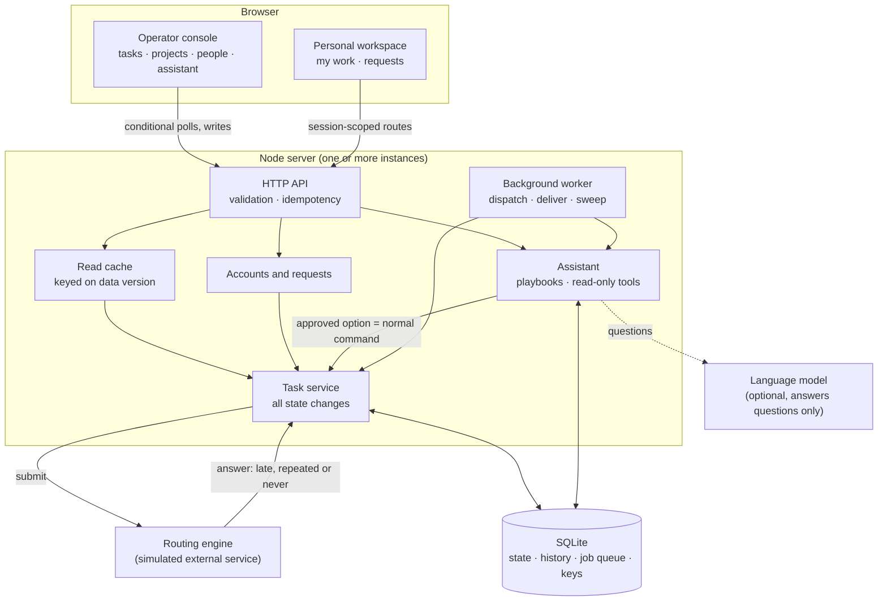
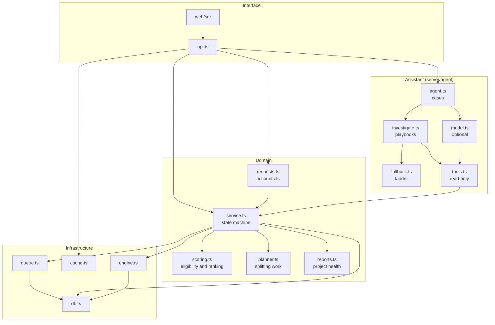
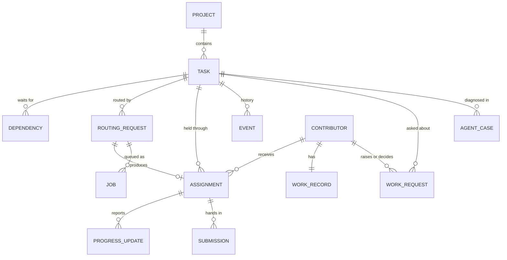
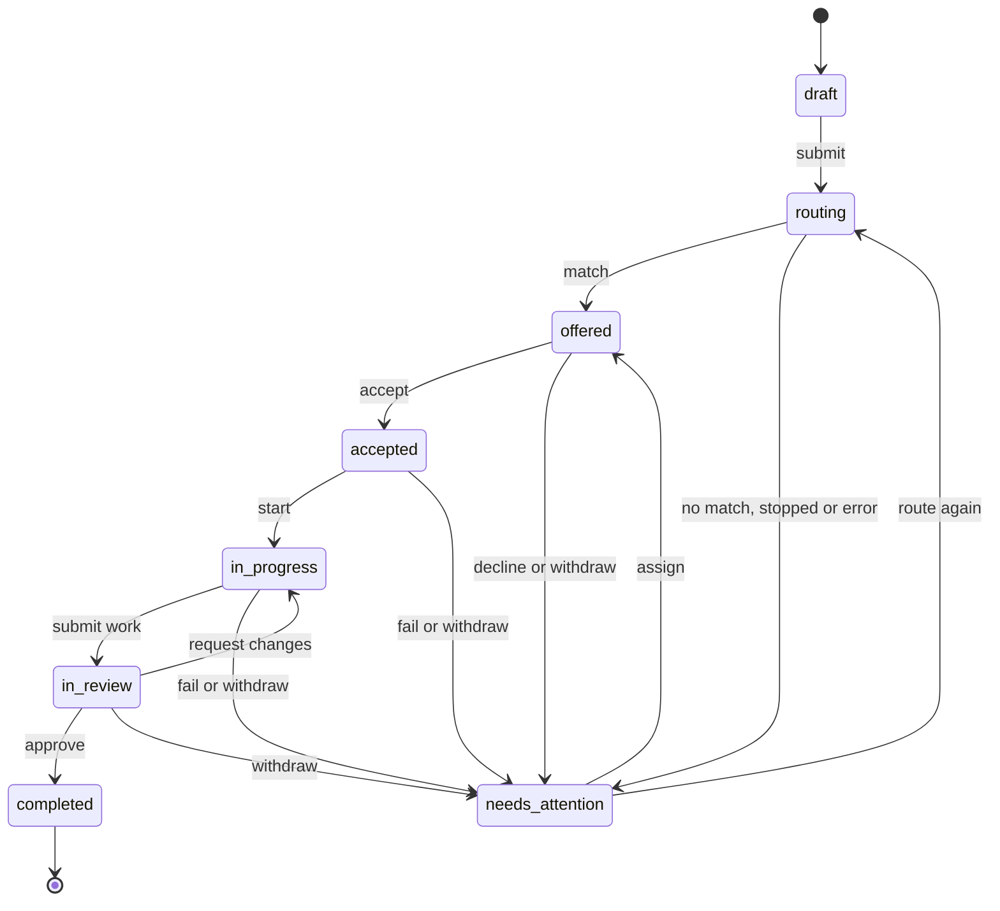
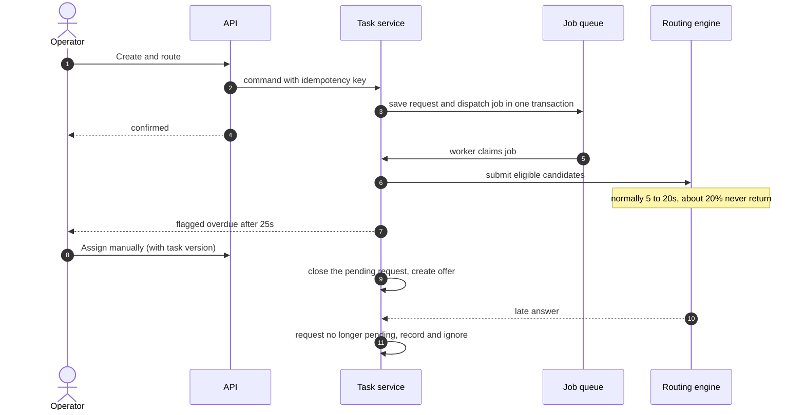
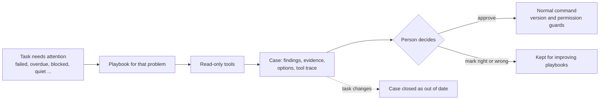
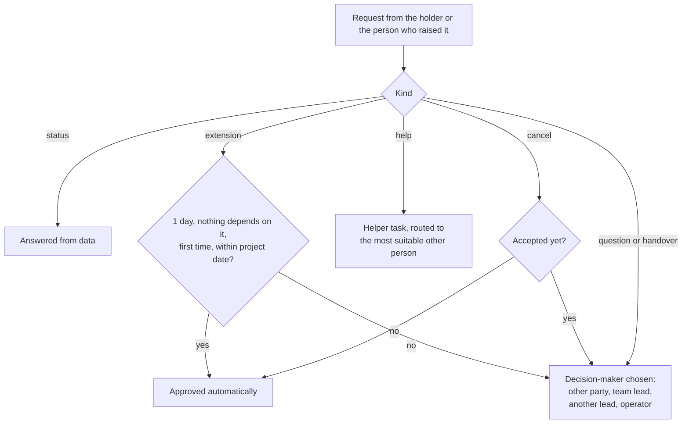

# Task Router

Routes work to the people able to do it, across branches and teams, and keeps a person in
control when automation cannot finish the job.

- **Routing** in the background against an engine that can be slow, wrong, or never answer.
- **Durable by design:** a transactional job queue, idempotent writes and database-enforced rules.
- **Explainable delegation:** hard requirements first, then a ranking with its reasons.
- **Work tracking:** projects, dependencies, progress, blockers, submissions and review.
- **An assistant** that diagnoses stuck work with read-only tools, proposes options and waits
  for approval. It runs on fixed rules; a language model is optional.
- **Requests** from the people doing the work, answered, automated or sent to the right person.

TypeScript throughout. Node's built-in HTTP server and SQLite, a React console, and no
infrastructure to install.

## Contents

[Architecture](#architecture) · [How work flows](#how-work-flows) · [Quick start](#quick-start) ·
[Using it](#using-it) · [Design decisions](#design-decisions) · [Testing](#testing) ·
[Limitations](#limitations) · [Documentation](#documentation)

## Architecture

### System



### Modules



`shared/types.ts` holds the domain types and the table of which actions each state allows. The
server enforces that table and the console renders from it.

### Data model



## How work flows

### Task lifecycle



Any task that is not finished can also be cancelled. An operator can reassign at most stages.
A task has **at most one active assignee**, enforced by a database index.

### Routing, including a late answer



### When something needs a person



### Requests on a task



## Quick start

Requires **Node 24 or newer**. There is no database to install.

```bash
npm install
```

```bash
npm start
```

Open `http://127.0.0.1:3001`.

On first start an empty database is filled with a small starting set: six contributors with
placeholder names and seven tasks that show routine work, a declined offer, an unanswered
routing request and a task nobody can take.

### Your organisation file

To use your own people instead, delete any local data, load a JSON file, then start with
`SEED=off`:

```bash
npm run reset
```

```bash
npm run import -- organisation.json
```

```bash
SEED=off npm start
```

The file format:

```text
{
  "contributors": [
    {
      "id": "<unique id>",                          required
      "name": "<full name>",                        required
      "branch": "<branch>",                         required
      "levels": { "<expertise>": <1 to 5> },        required, at least one
      "title": "<job title>",
      "team": "<team>",                             defaults from the first expertise
      "seniority": "junior | mid | senior | principal",
      "lead": true | false,
      "skills": ["<skill>"],
      "certifications": ["<certification>"],
      "languages": ["<language>"],
      "weeklyHours": <number>,                      default 40
      "joined": "<YYYY-MM>",
      "record": { "completed": <count>, ... }       optional history, applied once
    }
  ]
}
```

| Setting | Values (defined in [`shared/types.ts`](shared/types.ts)) |
|---|---|
| Branches | London, New York, Singapore, Bengaluru |
| Expertise | finance, healthcare, data analysis, operations, legal |

The whole file is validated before anything is saved. Running the import again updates people
by `id` without touching their work or record.

## Using it

| Goal | Where |
|---|---|
| Create and route a task | **Tasks** → New task |
| Step in: reassign, stop, withdraw, cancel | Select a task |
| Plan a project from a description | **Projects** → Plan a new project, then review the proposed steps |
| See who fits a task and why | A task → *Who fits this task?* |
| Review someone's profile or mark them away | **People** |
| Work through problems | **Assistant** |
| Act as a team member | Header menu → choose a name, then raise tasks or make requests |

**Simulation controls.** The routing engine and people's replies are simulated. Routing dialogs
let you force a match, no match, a slow answer or no answer, and the task panel can submit a
contributor's response.

### Configuration

| Variable | Default | Purpose |
|---|---|---|
| `PORT` | `3001` | HTTP port, bound to localhost |
| `DB_PATH` | `data/app.db` | SQLite file. Several instances may share it |
| `ROUTING_TIME_SCALE` | `1` | Compresses simulated engine timing, for testing |
| `SEED` | on | `off` starts an empty database without the starting set |
| `ASSISTANT_MODEL` | off | `on` lets a language model answer questions about cases. Uses the Anthropic API and its standard credentials. See [the assistant](docs/ASSISTANT.md#optional-language-model) |

```bash
npm run reset
```

deletes all local data. Stop the server first. For development, run `npm run dev:server` and
`npm run dev:web` in two terminals.

## Design decisions

| Decision | Reason | Cost |
|---|---|---|
| An overdue request is flagged, not auto-resolved | Slow and lost cannot be told apart | A lost request waits for a person |
| A person's decision beats a pending request | Late answers must never undo it | Some engine work is discarded |
| Commands carry the version the person saw | No silent overwrites between operators | Occasional "review and retry" |
| Queue, cache and keys live in the database | One transaction covers change, job and key | A single writer on a single machine |
| Eligibility rules are separate from ranking | Requirements are never traded for score | Some tasks find nobody |
| The assistant cannot write | Mistakes stay suggestions | A person must approve each action |
| Rules before models | Same data, same decision, testable | Narrow understanding of free text |

## Testing

```bash
npm run check
```

Type check, 126 tests and a production build. The tests cover the lifecycle, race conditions,
restarts, queue failures, a full disk, permissions, planning, scoring, the assistant and its
safeguards.

```bash
npm run stress
```

Runs real server processes under concurrent load, kills them with `SIGKILL`, then runs 23
consistency checks on the database. In the largest run (50,000 existing tasks, 20,000 new,
three instances, 27 kills) all checks passed at about 570 new tasks per second. Figures and
their limits are in [Reliability and performance](docs/RELIABILITY.md).

## Limitations

This is a single-machine system that demonstrates an architecture, not a hardened product.

- **No authentication.** Signing in as a person has no password, and the operator console is
  open. The server listens on localhost only. Do not expose it.
- **One machine, one writer.** More instances add failover, not write throughput.
- **Simulated engine.** No real routing service is connected.
- **Keyword understanding.** Splitting and classifying work matches words against playbooks.
- **Performance records are partial.** They ignore difficulty and unrecorded help, and should
  not be used for appraisal or pay.
- **The language model path is tested only against a stand-in**, not a live API.
- No notifications, schema migrations, archiving or browser tests.

## Documentation

| Document | Covers |
|---|---|
| [Architecture](docs/ARCHITECTURE.md) | Transactions, queue, concurrency, restarts, caching |
| [Delegation](docs/DELEGATION.md) | Requirements, scoring, planning, tracking |
| [Assistant](docs/ASSISTANT.md) | Tools, playbooks, fallbacks, safeguards |
| [People and requests](docs/REQUESTS.md) | Roles, raising work, request handling |
| [Reliability and performance](docs/RELIABILITY.md) | Guarantees, failure cases, measurements |
| [HTTP API](docs/API.md) | Endpoints, headers, errors |

## Project layout

```text
server/    HTTP API, domain logic, queue, simulated engine
  agent/   assistant: tools, playbooks, fallback ladder, optional model
shared/    types and the action table used by server and console
web/       React console
scripts/   stress test and benchmark
test/      automated tests
docs/      detailed documentation
```
