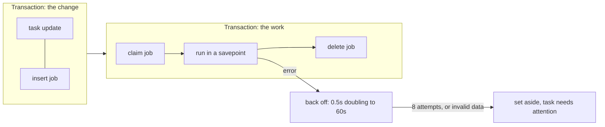

# Architecture

[← Back to the README](../README.md)

## Principles

1. Every state change happens in one place (`service.ts`) and in one transaction.
2. Rules that must never break are database constraints.
3. Anything that can arrive late, twice or never is assumed to.
4. Automation proposes or acts within stated rules. People can always step in.

## Records

| Record | Role |
|---|---|
| Task | Current state and requirements |
| Routing request | One attempt: `pending`, `matched`, `no_match`, `superseded` or `failed` |
| Assignment | Who held the task and how it ended |
| Event | Append-only history, readable as the story of the task |
| Job | Background work still to be done |
| Idempotency key | The stored answer to a write already applied |

Constraints enforced by indexes: one active assignment per task, one pending routing request
per task, one assignment per routing request, one open assistant case per task, one live
request of each kind per person per task.

## The job queue

- A job is claimed, executed and removed in **one transaction**. A crash rolls back all three,
  so delivery is at least once and the effect on this database is exactly once.
- Jobs run in batches of about 25ms and commit together, which bounds how long web requests
  wait and shares one disk sync across the batch.
- Each job has its own savepoint, so a failing job neither blocks nor undoes the others.
- Order is by age, with a head start for priority: urgent work goes first without starving
  older work.

A handler that called a real network service could not hold a transaction open. It would need a
lease on the job and a receiver that deduplicates by request id.

## Receiving engine answers

The engine delivers at least once. An answer is marked delivered only in the transaction that
queues it. Applying it checks that the request is still pending and has no recorded answer, so
repeats do nothing. Before making an offer the service rechecks that the chosen person is still
available, in the right branch, qualified and within capacity.

## Concurrency

| Race | Guard |
|---|---|
| Engine answers after a person acted | The request is closed in the person's transaction; late answers are logged only |
| Two operators act on one task | Commands carry the task version; the second is told who acted first |
| A replaced contributor replies | Responses name their assignment |
| A client repeats a write | The idempotency key is committed with the change and replays the first answer |
| Two instances take the same work | The database's single writer serialises claims |
| A chosen person fills up meanwhile | No offer; routing retries up to three times, then asks a person |

## Restarts and failures

There are no in-memory timers. Pending work, the engine's schedule, jobs and sessions are in the
database, so a restarted or second instance carries on.

| Failure | Behaviour |
|---|---|
| Process killed | Uncommitted work rolls back and is repeated |
| Database locked too long | `503` with `Retry-After`; clients retry with the same key |
| Disk full | `507`, nothing partly saved |
| Invalid engine answer | Not retried; task needs attention with the error |
| Database from an older schema | Refuses to start and asks for a reset |

## Reads and caching

Lists are filtered, sorted, counted and paged by the database, one query per page. Triggers
increment a data version on every change. Responses are cached per URL (and per person for
signed-in routes) against that version and served as `ETag`s, so unchanged data costs a `304`.
The version lives in the database, so a write through any instance invalidates every cache.

Under continuous writes the cache rarely hits. Speed then comes from indexes and paging.

## Moving beyond one machine

1. Replace SQLite with a server database for concurrent writers, replicas and backups.
2. Claim jobs with row locks and leases (`FOR UPDATE SKIP LOCKED` or equivalent).
3. Run the assistant in its own process.
4. Cache versions per branch.
5. Add single sign-on, scoped roles, metrics and alerts.
