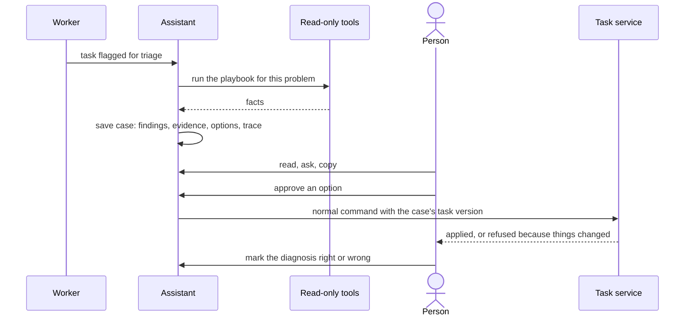
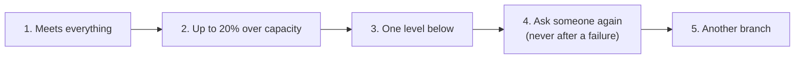

# The assistant

[← Back to the README](../README.md)

When a task needs a person, the assistant investigates, writes up what it found, offers options
and waits. Its useful behaviour does not depend on a language model.



## Who decides what

| Decision | Made by |
|---|---|
| Eligibility and ranking | Rules |
| What went wrong and which options exist | Playbooks |
| Fallbacks when nobody fits | A fixed ladder |
| Whether anything happens | A person |
| Answers to follow-up questions | Rules, or optionally a model that can change nothing |

## Tools

All are read-only and fixed to the case's task: `get_task`, `get_history`,
`get_routing_attempts`, `get_assignments`, `rank_candidates`, `get_team_lead`, `get_person`,
`get_dependencies`, `find_similar`, `get_engine_health`. Inputs are checked and every call is
recorded. No tool writes.

## Problems covered

No match, declined, failed, stopped, withdrawn, person unavailable, over capacity, routing
error, routing overdue, blocked, holder away, past due and no recent report.

## Fallback ladder



Certification and expertise are never set aside, and never two rules at once. An option that
sets a rule aside is labelled and **never marked recommended**. If more than 40% of recent
requests are unanswered (20% is expected), or an answer is unusable, assigning from the local
ranking is offered first.

## Cases

Each finding is marked **Recorded** (read from data), **Inferred** (a stated rule applied to it)
or **Unknown**. A case keeps its evidence, tool calls, questions, the option chosen and by whom.
A failed investigation is saved as a case that says so. If the task changes, the case closes as
out of date and its options cannot run.

## Optional language model

Off by default. With API credentials in the environment (for example `ANTHROPIC_API_KEY`):

```bash
ASSISTANT_MODEL=on npm start
```

The model only answers questions about a case, in a loop of at most six turns run by this
server, using the tools above. The model identifier is set in
[`model.ts`](../server/agent/model.ts).

| Risk | Control |
|---|---|
| Taking an action | No write tools exist |
| Instructions hidden in task text | Same: the worst case is a misleading answer |
| Made-up support | Answers must cite evidence ids that exist, or are discarded |
| Failure, refusal, timeout or looping | The rule-based answer is used and the reason shown |
| Exposing people | Contributor names, and operator names on the task, become placeholders |

A cited answer can still misread its evidence. Task text, notes and performance figures are sent
to the provider and may identify people, so check your data obligations first. This path has
been tested only against a stand-in, not a live API.

## Limits

Playbooks reason about one task at a time. "Similar cases" is a count, not root-cause analysis.
Investigations share the server process, so a flood of problems queues up, most urgent first.
Cases are not archived.
