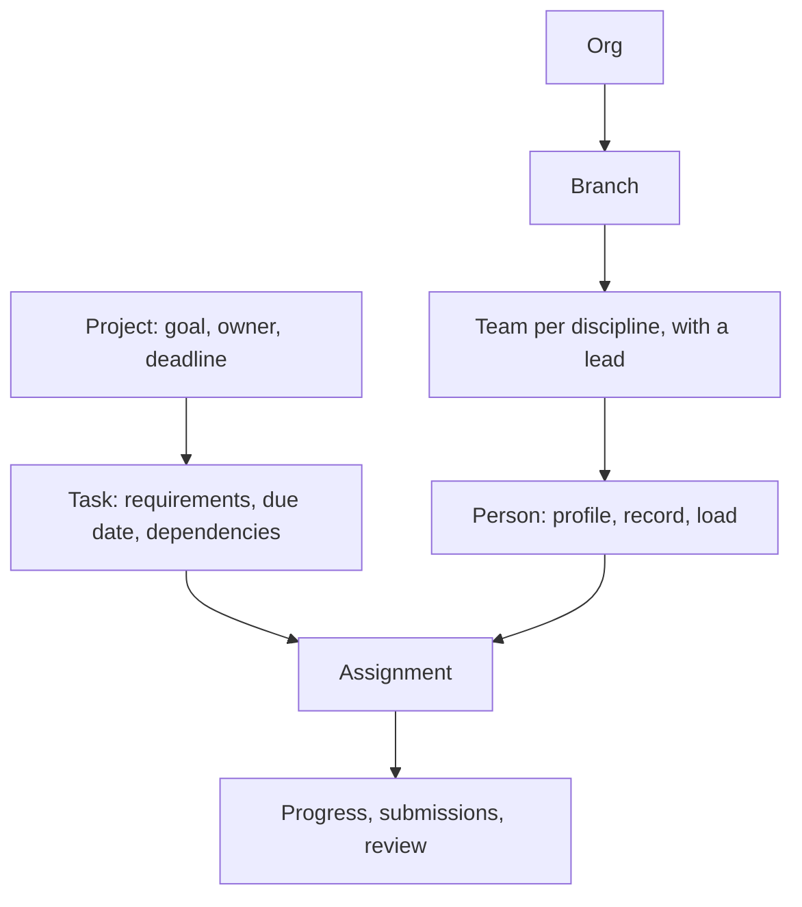
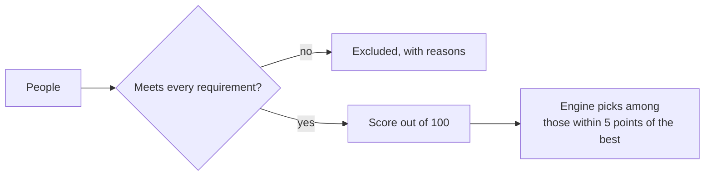

# Delegation, planning and tracking

[← Back to the README](../README.md)

## Structure

Splitting work produces separate tasks, so each still has at most one active assignee.

## Choosing a person

### Requirements

Routing never overrides these.

| Requirement | Source |
|---|---|
| Available | Marked by an operator |
| Same branch | Task and person |
| Expertise at or above the minimum level (1–5) | Profile |
| Certification, if the task names one | Profile |
| Held hours plus the estimate within weekly capacity | Open assignments |
| Has not declined, failed or been withdrawn from this task | History |
| Did not raise the task | Task |

An operator may assign anyone available, giving a reason for each requirement set aside.

### Ranking

| Factor | High | Normal | Low | Measured as |
|---|---|---|---|---|
| Skill fit | 25 | 30 | 20 | Level, and share of requested skills |
| Quality | 25 | 20 | 15 | Review rating and approval without changes |
| Reliability | 30 | 20 | 15 | Submitted by the due date, and not failed |
| Capacity | 10 | 20 | 35 | Share of the week free after this task |
| Responsiveness | 10 | 10 | 15 | Acceptance rate and time to reply |

Every score is shown with its factors and the counts behind them. The weights are a design
judgement held in one table in [`scoring.ts`](../server/scoring.ts).

### Fairness and limits

- Small samples are pulled towards a neutral prior and labelled as limited history.
- Offers taken back, or withdrawn because someone was unavailable, do not affect their record.
- Timeliness is measured at submission, so slow review does not make anyone late.
- Only work events are tracked. There is no presence or screen monitoring, and no personal
  attribute is an input.
- The measures miss difficulty and help given to others, ratings carry reviewer bias, and
  ranking by record favours those who already have one. They are not an appraisal tool.
- A deployment needs access control, a way to dispute a record, and legal review of automated
  allocation.

## Splitting work

[`planner.ts`](../server/planner.ts) matches words in a description against playbooks and orders
the steps: gather data, assess, legal review, rollout. This is **keyword matching, not
understanding**. Each step shows the words that triggered it, who could take it, and a warning
if nobody can or the deadline looks impossible. Nothing is created until a person has edited and
confirmed the plan. A project is created whole or not at all.

## Tracking

| Signal | Raised when | Cleared by |
|---|---|---|
| Blocked | The holder reports a blocker | An operator clears it, or the work moves on |
| No recent report | 24 hours without activity on accepted work | A progress report |
| Past due | The due date passes before approval | Closing the task |
| Awaiting review | Work is submitted | Approval with a rating, or a request for changes |

A project is **complete** when every live task is approved, **off track** when a deadline has
passed or the longest unfinished chain exceeds the working hours left, **at risk** when anything
needs a manager or a step has nobody who can take it, and otherwise **on track**. The report can
be copied as a text status update.

## Not covered

Editing a project after creation, managing profiles in the console, assigning reviewers,
holidays and time zones in estimates, file uploads and reminders.
