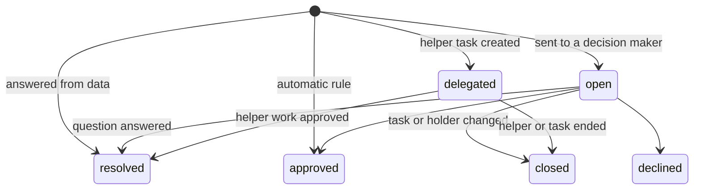

# People and requests

[← Back to the README](../README.md)

## Signing in

Choose a name from the header menu to see what that person sees. The session lives in one browser
tab, so two tabs can be two people.

> **This is not authentication.** There is no password, anyone can sign in as anyone, and the
> operator console needs no sign-in. It demonstrates the boundary each role would have: a request
> carrying a session reaches only that person's own routes.

| A signed-in person can | Cannot |
|---|---|
| See work assigned to them and tasks they raised | See other tasks, profiles, scores or cases |
| Raise a task in their branch | Be routed their own task |
| Respond to their own assignments | Respond for someone else |
| Review work they asked for | Review their own work |
| Make requests, and decide those sent to them | Decide anyone else's |

## Raising a task

If the kind of work is not chosen, it is read from the words used. The strongest match wins. A
tie or no match is returned to the person to choose, and the screen shows which words were used.

## Request handling

| Request | Who may ask | Handling |
|---|---|---|
| Status | holder, raiser | Answered at once from the data |
| Question | holder, raiser | The other party, else the team lead, else an operator |
| Help | holder who accepted | A 2 hour helper task, one level below the original minimum, routed to someone else |
| Extension | holder who accepted | Automatic if 1 day, nothing depends on it, first time and within the project date. Otherwise the raiser, lead or operator |
| Handover | holder who accepted | A lead approves; the best eligible person is chosen then, or the task returns to operators |
| Cancel | raiser | At once if nobody accepted it, otherwise a lead approves |

- A lead is the team lead for that expertise, else the least loaded other lead in the branch.
- If a decision maker becomes unavailable, their open requests move on.
- One live request of each kind per person per task.

## Not covered

Real authentication, notifications, escalation when a decision maker is silent, raising work for
another branch, withdrawing a request, and choosing the person when approving a handover.
